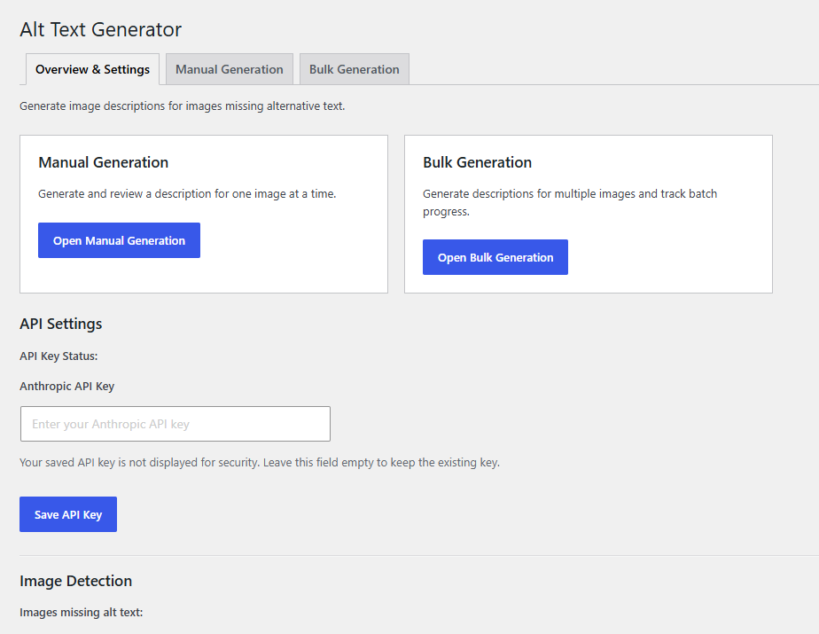
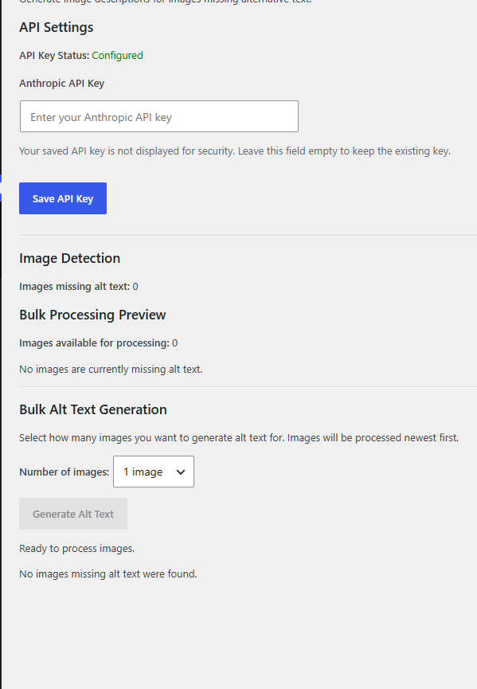
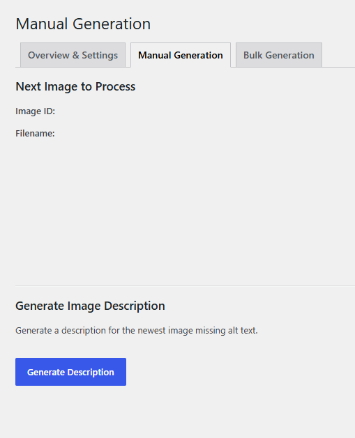
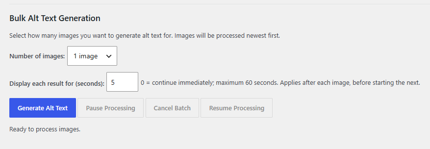
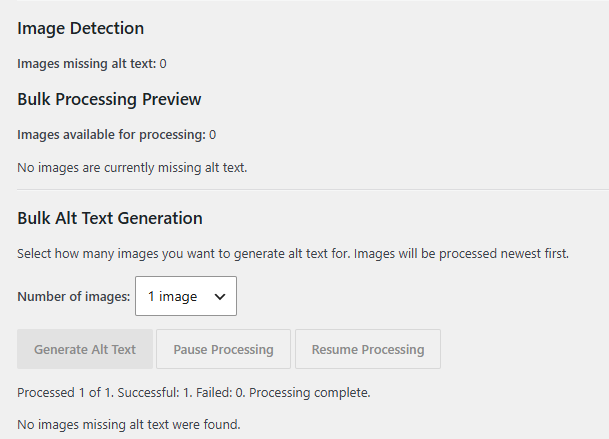
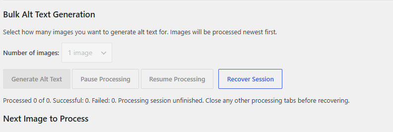
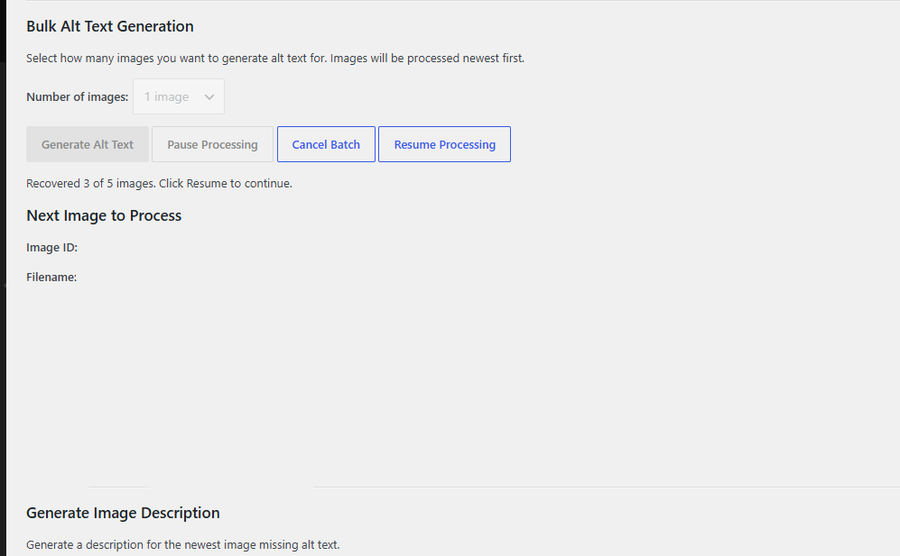

# AI Alt Text Generator

A WordPress plugin that uses artificial intelligence to generate missing image alternative text through manual and bulk processing.

## Project Purpose

The AI Alt Text Generator was developed to reduce the time and manual effort required to write alternative text for images in WordPress.

The plugin uses the Anthropic API to generate image descriptions, helping website administrators improve accessibility and manage large media libraries more efficiently.

---

## 🧰 Technologies Used

---

## Features

- Automatically detect images with missing alt text.
- Generate and review individual image descriptions before saving.
- Process batches of 1, 5, 10 or all eligible images.
- Process images in newest-first order.
- Pause, resume and cancel bulk processing.
- Recover interrupted processing sessions.
- Monitor successful and failed image processing.
- Configure processing delays between 0 and 60 seconds.
- Configure an Anthropic API key through the WordPress administration interface.

---

## 📸 Screenshots

Some screenshots were captured during development. Images, filenames and identifying information have been redacted to protect confidentiality.

### Overview and Settings

Configure the API key and access manual and bulk generation.

### Image Detection

Identify images missing alternative text and prevent processing when no eligible images remain.

### Manual Generation

Preview and generate descriptions for individual images.

### Bulk Generation

Configure batch sizes and processing delays.

### Successful Batch Completion

Display processing results, including successful and failed images.

### Session Recovery

Detect an interrupted processing session and provide recovery controls.

### Recovered Batch

Restore previous processing progress before continuing a batch.

---

## Installation

1. Obtain a copy of the plugin.
2. Open the WordPress administration dashboard.
3. Navigate to Plugins > Add New > Upload Plugin.
4. Upload the plugin ZIP file.
5. Install and activate AI Alt Text Generator.
6. Navigate to Media > Alt Text Generator.

Alternatively, place the extracted plugin folder inside `wp-content/plugins/` and activate it through WordPress.

## Configuration

1. Create an Anthropic account.
2. Obtain an API key from the Anthropic Console.
3. Ensure API access and billing are configured.
4. Open the plugin's Overview & Settings page.
5. Enter and save your API key.
6. Navigate to Manual Generation or Bulk Generation.

No source-code modifications are required for normal use.

---

## Technical Challenges and Solutions

### Bulk Image Processing

Processing multiple images required a way to manage individual API requests and track progress.

Sequential processing was implemented with configurable batch sizes and delays, allowing users to control processing and monitor results.

### Interrupted Processing Sessions

Bulk processing sessions could be interrupted before all images were completed.

Session persistence and recovery functionality were implemented to restore previous progress and allow processing to continue.

### API Key Handling

The plugin required API authentication without exposing credentials in the source code or displaying the saved key in the administration interface.

The API key is configured through WordPress settings and retrieved server-side when making API requests.

### Image Validation

Images needed to be validated before being submitted to the Anthropic API.

File format and size checks were implemented to prevent unsupported images from being submitted.

---

## 🧪 Testing

The plugin was tested throughout development in a WordPress environment.

| Test | Expected Result | Observed Result |
|---|---|---|
| API key display | Saved API key is not displayed | Confirmed |
| Image detection | Images missing alt text are identified | Confirmed |
| Empty processing queue | Generation is disabled when no eligible images remain | Confirmed |
| Bulk image processing | Selected image is processed successfully | 1 successful, 0 failed |
| Interrupted session detection | Recovery controls are displayed | Confirmed |
| Session recovery | Previous processing progress is restored | 3 of 5 images recovered |
| Batch cancellation | Processing stops and saved descriptions are retained | Confirmation message displayed |

These results relate to development testing. The standalone version requires further testing before release.

---

## Source Code Structure

    ai-alt-text-generator/
    ├── admin/
    │   ├── admin-page.php
    │   ├── admin.css
    │   └── admin.js
    ├── includes/
    │   ├── image-handler.php
    │   └── claude-api.php
    ├── screenshots/
    │   ├── overview-settings.png
    │   ├── image-detection.png
    │   ├── manual-generation.png
    │   ├── bulk-generation.png
    │   ├── bulk-completion.png
    │   ├── session-recovery.png
    │   └── batch-recovered.png
    ├── alt-text-generator.php
    └── README.md

| File | Purpose |
|---|---|
| `alt-text-generator.php` | Plugin registration, settings and request handlers |
| `admin/admin-page.php` | WordPress administration interface |
| `admin/admin.css` | Interface styling |
| `admin/admin.js` | Bulk processing and session controls |
| `includes/image-handler.php` | Image detection and alt text handling |
| `includes/claude-api.php` | Image validation and Anthropic API integration |

---

## Developer Configuration

Developers can customise the following settings within `includes/claude-api.php`:

- AI model identifier.
- Image description prompt.
- Output token limit.

Any modifications should be tested on a separate WordPress installation before deployment.

---

## Requirements and Limitations

- WordPress installation with administrator access.
- Anthropic API key with API access and billing configured.
- Outbound HTTPS connectivity to Anthropic.
- Locally accessible JPEG, PNG, GIF or WebP images.
- Maximum image file size of 5 MB, subject to additional API limits.
- Access to the configured Claude model (`claude-haiku-4-5-20251001`).

AI-generated descriptions may be inaccurate or lack context. Descriptions should be reviewed for accuracy and accessibility.

Images that intentionally contain empty alt text, such as decorative images, may also be detected as missing alternative text.

Automatic uninstall cleanup is not implemented in this version.

## Security and Privacy

Images are read from disk, base64-encoded and submitted to the Anthropic API.

Only process images that you are authorised to share with the external service. API usage charges may apply.

API credentials should never be committed to GitHub or shared publicly.

---

## Project Status

**Version:** 1.0.0

Developed and tested during development. Final standalone WordPress testing and publication approval are pending.

---

## Author

**Mohsin Chughtai**

Digital Software Development T Level student and aspiring Software Engineer.

